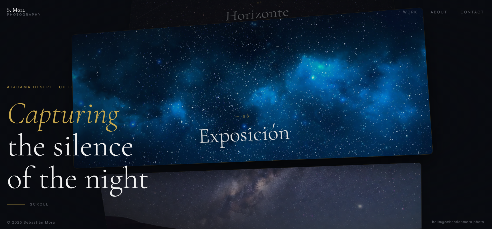

# 🌌 Sebastián Mora — Portfolio de Fotografía Nocturna

Un asombroso portfolio web diseñado para destacar la fotografía nocturna, caracterizado por una paleta íntima (60-30-10) y un **innovador Slider 3D Parabólico** (Coverflow Nativo) de altísimo rendimiento impulsado puramente por transformaciones CSS aceleradas por GPU, capaz de alcanzar **100% de performance en Lighthouse**.

## ✨ Características Especiales

- **Animación "CoverFlow" Parabólica**: 100% Nativo DOM CSS `translate3d`. Sustituye las costosas y lentas mallas de Three.js por manipulación hiper-optimizada en el Compositor Layer del navegador (Cero pérdida de frames en dispositivos móviles).
- **Scroll Infinito y Sedoso**: Implementado con [Lenis](https://lenis.studiofreight.com/), dotando al sitio de una fluidez espectacular que enlaza su bucle sin fin.
- **GSAP Loader Anti-FOUC**: Secuencia de apertura elegante en dos fases, oculta tras una cortina negra absoluta para prevenir destellos des-estilizados de carga.
- **Glassmorphism Dinámico**: Navbar, overlays y elementos flotantes inter-reactivos.
- **Diseños y Proporciones Widescreen Profesionales**: Optimización cinemática visual para presentar medios pesados y vibrantes.

## 🚀 Tecnologías

- **Vite** — Entorno de desarrollo ultrarrápido y empaquetador eficiente.
- **Vanilla JavaScript Modules (ESM)** — Lógica de componentes ligeros e independientes sin librerías de UI como React/Vue.
- **Lenis** — Manejo suave de interpolación de ruedas (Smooth Wheel Infinity Wraparound).
- **GSAP** — Animación coreográfica robusta (GreenSock).
- **Vercel** — Preparado para despliegue instantáneo mediante el archivo de reglas propio (`vercel.json`).

---
**Diseñado y codificado con dedicación ☕ por [JavGarin](https://javiergarin.dev/).**
